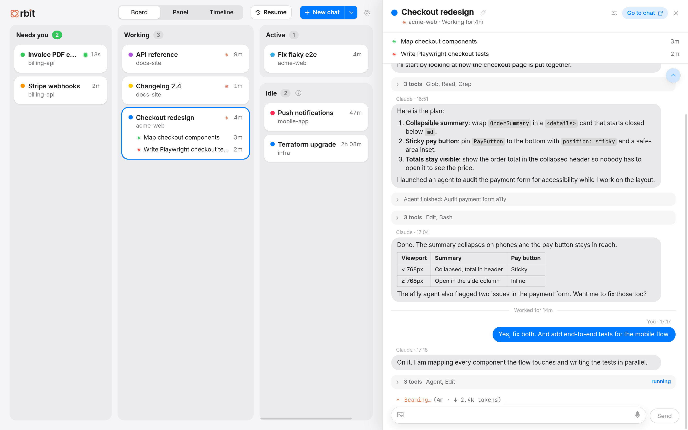
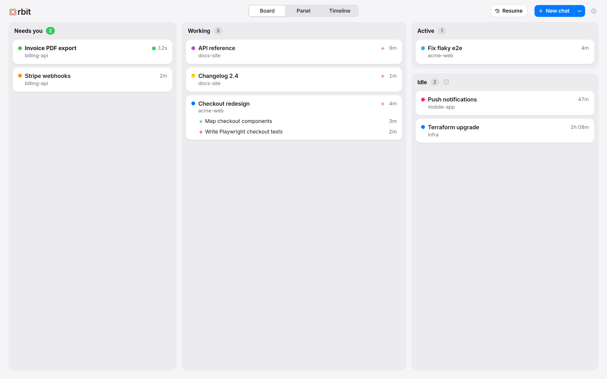
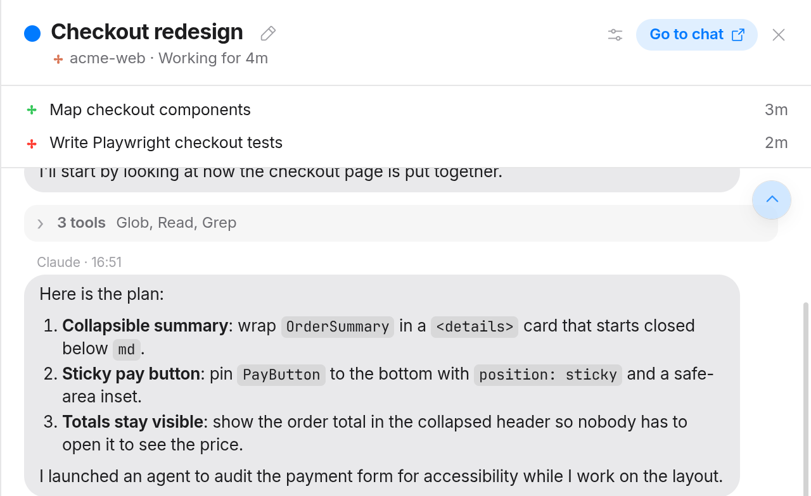
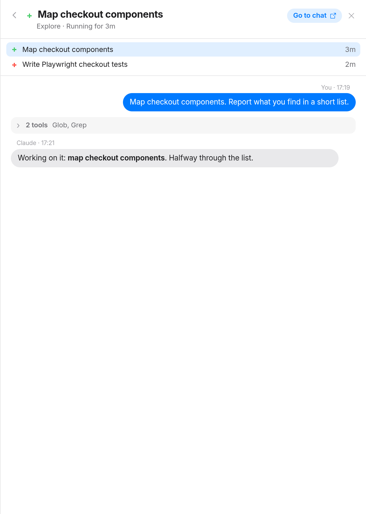
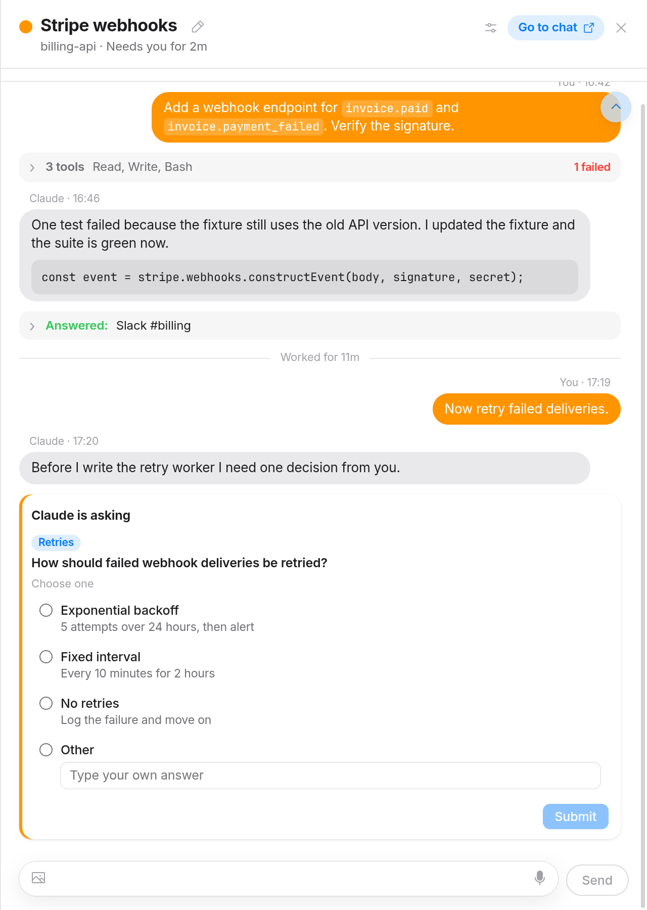
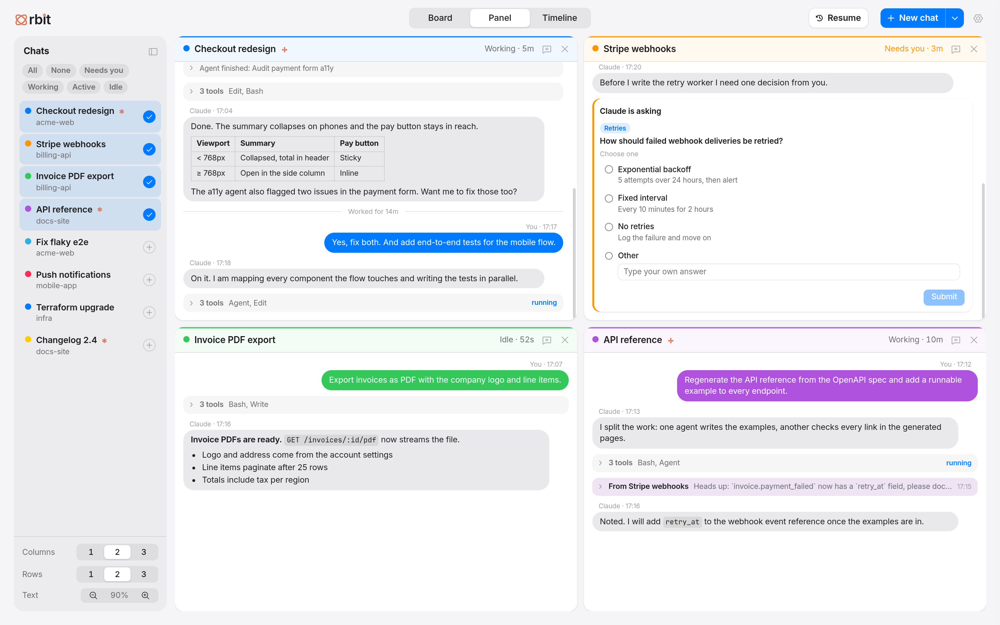
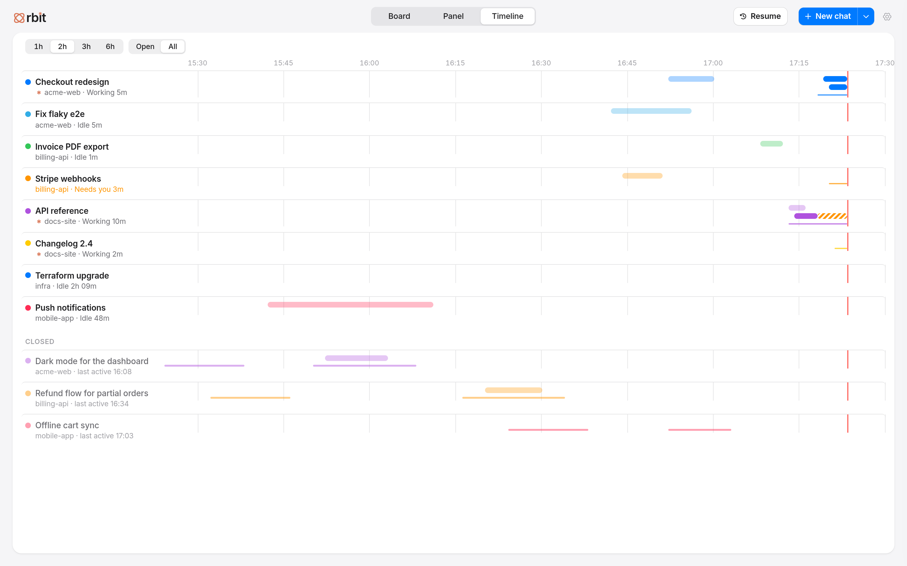
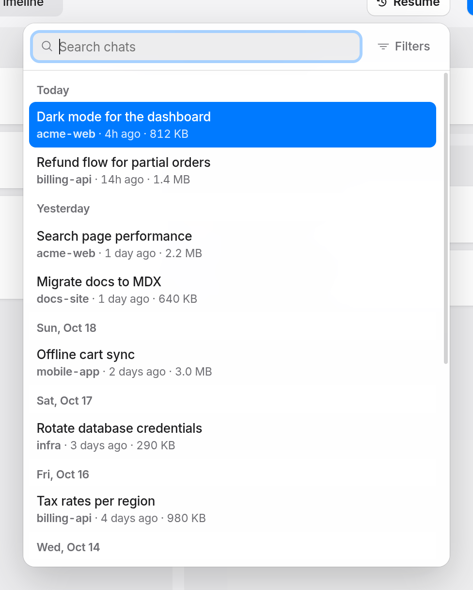
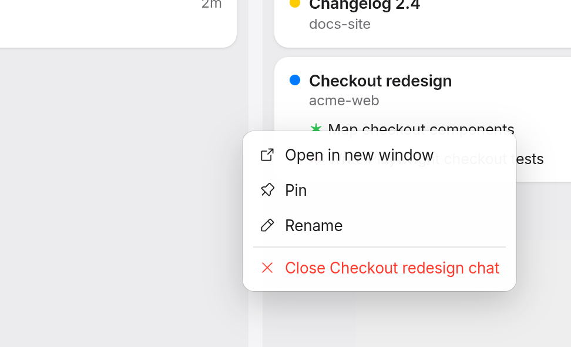

<div align="center">


# Orbit

**One window to watch and steer every Claude Code chat open on your Linux desktop.**

[](LICENSE.md)
[](#requirements)
[](#requirements)
[](#development)

<br />

<picture>
  <source media="(prefers-color-scheme: dark)" srcset="docs/screenshots/hero-dark.png" />
  
</picture>

<sub>Every screenshot comes from <a href="#demo-mode">demo mode</a>: the chats, repositories and numbers are made up.</sub>

</div>

---

Running five Claude Code chats in five terminals means constantly hunting for the one that finished,
the one waiting for a permission prompt, and the one whose agents went quiet. Orbit reads what
Claude Code already writes to disk and shows every open chat on one board: what each is doing, which
need you, what their agents are up to. You can read a chat, reply, answer its questions and
start or resume chats without leaving the window.

## Contents

- [Features](#features)
- [Requirements](#requirements)
- [Install and run](#install-and-run)
- [Keyboard shortcuts](#keyboard-shortcuts)
- [How it works](#how-it-works)
- [Privacy](#privacy)
- [Orbit Web (remote access)](#orbit-web-remote-access)
- [Demo mode](#demo-mode)
- [Configurable assumptions](#configurable-assumptions)
- [Development](#development)
- [Contributing](#contributing)
- [License](#license)

More detail: [Feature guide](docs/features.md) · [Architecture](docs/architecture.md)

## Features

### Board: who needs you, who is working

Chats sort themselves into **Needs you** (a permission prompt, a question, or a reply you have not
read yet), **Working**, **Active** and **Idle**. Each card shows the chat's `/color`, repository, time
in its status and every running agent, with agents that stopped writing flagged as *quiet*.

<picture>
  <source media="(prefers-color-scheme: dark)" srcset="docs/screenshots/board-dark.png" />
  
</picture>

### Chat panel: read and reply without switching windows

Click a card to open the chat beside the board: rendered markdown, tool calls folded into groups,
agent and slash-command notices, turn dividers, and a composer that sends straight into the chat's
terminal. Paste or drop images, rename the chat, change its color, or jump to its terminal.
Hold <kbd>Space</kbd> to dictate.

### Agents at a glance

The chat's live agents sit under the panel header. Click one to read its own transcript.

<table>
  <tr>
    <td width="50%">
      <picture>
        <source media="(prefers-color-scheme: dark)" srcset="docs/screenshots/agents-dark.png" />
        
      </picture>
    </td>
    <td width="50%">
      <picture>
        <source media="(prefers-color-scheme: dark)" srcset="docs/screenshots/agent-view-dark.png" />
        
      </picture>
    </td>
  </tr>
</table>

### Answer Claude's questions

When Claude asks a multiple-choice question (`AskUserQuestion`), the panel shows it as a form at the
end of the thread. Pick an answer there instead of in the terminal.

<picture>
  <source media="(prefers-color-scheme: dark)" srcset="docs/screenshots/question-dark.png" />
  
</picture>

### Panel: several chats side by side

Pick chats from the sidebar to tile them in a grid of live transcripts, each with its own composer.
Choose 1 to 3 columns and rows, drag headers to reorder, and scale the text.

<picture>
  <source media="(prefers-color-scheme: dark)" srcset="docs/screenshots/panel-dark.png" />
  
</picture>

### Timeline: what happened over the last hours

One lane per chat, one bar per agent, and a line for how long each chat has been working or waiting.
Switch to **All** to also see chats closed during that window.

<picture>
  <source media="(prefers-color-scheme: dark)" srcset="docs/screenshots/timeline-dark.png" />
  
</picture>

### Resume, card menu and usage

<table>
  <tr>
    <td width="50%" valign="top">
      <b>Resume</b> any past chat, searchable and filterable by date and repository.<br /><br />
      <picture>
        <source media="(prefers-color-scheme: dark)" srcset="docs/screenshots/resume-dark.png" />
        
      </picture>
    </td>
    <td width="50%" valign="top">
      <b>Right-click a card</b> to pop it out into its own window, pin, rename or close it.<br /><br />
      <picture>
        <source media="(prefers-color-scheme: dark)" srcset="docs/screenshots/card-menu-dark.png" />
        
      </picture>
    </td>
  </tr>
</table>

**Settings** switches between Light, Dark and Auto, and shows your Claude plan's session and weekly
limits with their reset times ([screenshot](docs/screenshots/settings-light.png)).

## Requirements

| What | Why |
| --- | --- |
| **Linux** with the **Hyprland** compositor | Window lookup, focus and workspaces go through `hyprctl` |
| **[kitty](https://sw.kovidgoyal.net/kitty/)** with remote control on a socket | Orbit types into chats through kitty's socket, without stealing focus |
| **[Claude Code](https://docs.claude.com/en/docs/claude-code) CLI**, logged in | Orbit reads the files it writes under `~/.claude` |
| **Node.js 22+** and npm | Build and run (Electron is installed as a dev dependency) |
| `git`, and optionally `wtype` | Repository names; `wtype` is the fallback for kitty windows without the socket |

Add these two lines to `~/.config/kitty/kitty.conf`, then **open new kitty windows** (the setting
does not apply to windows that already exist):

```conf
allow_remote_control socket-only
listen_on unix:${XDG_RUNTIME_DIR}/kitty-{kitty_pid}
```

## Install and run

```bash
git clone https://github.com/otaviosenne/orbit.git
cd orbit
npm install
npm start          # builds, then opens Orbit
```

Only one Orbit runs at a time: starting it again replaces the running one.

Optional:

- **Launcher entry**: copy `claude-radar.desktop` to `~/.local/share/applications/` and point its
  `Exec` and `Icon` lines at your clone.
- **Pin it to a workspace**: the hub window's class is `claude-radar` and its title is exactly
  `Orbit`, for example `windowrulev2 = workspace 2, class:(claude-radar), title:^(Orbit)$`.

## Keyboard shortcuts

| Keys | Action |
| --- | --- |
| <kbd>1</kbd> <kbd>2</kbd> <kbd>3</kbd> | Board, Panel, Timeline |
| <kbd>4</kbd> | Settings (the gear toggles back to the last view) |
| <kbd>Esc</kbd> | Close the open menu, leave an agent's transcript, then close the chat panel |
| <kbd>Enter</kbd> / <kbd>Shift</kbd>+<kbd>Enter</kbd> | Send / new line in a composer |
| Hold <kbd>Space</kbd> in the composer | Dictate while held (a tap still types a space) |
| <kbd>Space</kbd> with a chat open, outside a text field | Hold to talk, or tap to start and tap again to stop |
| <kbd>Ctrl</kbd> + mouse wheel | Scale the thread text (chat panel and Panel tiles) |
| Right-click a card | Open in new window, pin, rename, close |
| Drag the panel's left edge | Resize the chat panel (double-click resets) |

## How it works

- **Reading chats (read-only).** Every 2 seconds Orbit lists live sessions from
  `~/.claude/sessions/<pid>.json`, then reads the tail of each chat's transcript in
  `~/.claude/projects/*/<session>.jsonl` and its agents in `<session>/subagents/`. It never writes to
  these files.
- **Driving chats.** Messages, `/rename`, `/color` and question answers go through kitty's
  remote-control socket (`kitty @ send-text`), so the chat's window never takes focus. New and resumed
  chats open in a new kitty window through `hyprctl dispatch exec`.
- **Voice dictation.** Audio is streamed to Claude's own speech-to-text service (the one behind
  Claude Code's voice mode), authenticated with your local Claude Code OAuth token, which Orbit reads
  from `~/.claude/.credentials.json` and never refreshes or stores.
- **Usage.** The Settings view reads your plan's limits from Anthropic's usage endpoint with the same
  token.

See [docs/architecture.md](docs/architecture.md) for a diagram and the code layout.

## Privacy

- Everything runs locally. There is **no telemetry**, no analytics and no Orbit server. Orbit Web,
  when you turn it on, listens on `127.0.0.1` only and is reachable from elsewhere only through a
  tunnel or proxy you set up.
- **Read:** files under `~/.claude` (sessions, transcripts, agents, credentials), process info under
  `/proc`, and Hyprland and kitty state.
- **Sent over the network:** only to `api.anthropic.com`: the microphone audio while you dictate, and
  a request for your usage limits. Both carry your Claude Code token, exactly as Claude Code does.
- **Written:** images you attach go to `~/.cache/orbit/attachments` (deleted after 7 days); view
  preferences, pins and drafts live in Electron's local storage; New chat shortcuts you add are
  appended to the launcher's `shortcuts.tsv`.
- Links in messages open in your browser, never inside Orbit.

## Orbit Web (remote access)

Follow and steer your chats from your phone while the computer is on: Board, Timeline, Panel (one
column) and the chat panel, where you can read, send messages and images, answer questions,
interrupt, stop agents, and (on wide screens) switch model or mode. On a phone the board shows one
column at a time (tap or swipe), a chat opens full screen with only back, its dot and its name on
top, and a long press on a card opens its menu. It is the
same renderer as the desktop app, talking HTTP instead of IPC. Off by default.

1. **Settings → Orbit Web → Allow remote access.** Orbit listens on `http://127.0.0.1:4517` only.
2. Put it behind HTTPS: Cloudflare Tunnel (+ Cloudflare Access), `tailscale serve`, or a reverse
   proxy. Copy-paste steps are in [docs/remote.md](docs/remote.md#setup).
3. Type the public address into **External URL**, then scan the **QR code** with your phone.

**Security model.** A 256-bit token, created on first enable and stored in
`~/.config/orbit/remote.json` (mode 0600), is traded once for an `HttpOnly; Secure;
SameSite=Strict` cookie. Comparisons run in constant time, and failed sign-ins are rate-limited.
Writes must come from your own origin, unknown `Host` headers are refused, there is no CORS, and
every request is logged without the token. Closing chats, desktop windows, folder pickers, adding
shortcuts, dictation and Orbit Web's own settings stay desktop-only.
**The token is as good as a shell on your computer:** keep it private and press **New token** if a
phone is lost. Full details: [docs/remote.md](docs/remote.md).

## Demo mode

```bash
npm run demo
```

`ORBIT_DEMO=1` swaps every data source for made-up chats, agents, transcripts, past chats, timeline
history and usage numbers. Actions (send, rename, close, launch, resume, dictation) do nothing and
report success. Demo mode never reads `~/.claude`, never touches a terminal or the network, never
claims the single-instance lock (so it cannot close a running Orbit), and keeps its own profile.
All of it lives in [`src/demo/`](src/demo).

## Configurable assumptions

Orbit grew out of one desktop setup and still hard-codes a few of its conventions. They are
constants, easy to change in code:

| Assumption | Where |
| --- | --- |
| New and resumed chats open on Hyprland workspace `99` | `src/main/chat-workspace.ts` |
| New chat entries come from `~/.config/hypr/scripts/repo-launcher/list-entries.sh`; shortcuts are saved to `shortcuts.tsv` beside it | `src/main/launcher.ts`, `src/main/shortcut-store.ts` |
| Dictation language is Portuguese (`pt`) | `src/main/voice-stream.ts` |
| `/HD` and your home folder are "umbrella" repositories, so chats inside them are named after their own folder | `src/core/repository-resolver.ts` |
| The window's app id is `claude-radar` (window rules match it) | `src/main/main.ts` |
| Attachments are cached in `~/.cache/orbit/attachments` | `src/main/attachments.ts` |

## Development

```bash
npm run build      # esbuild: main, preload and renderer into dist/
npm test           # vitest
npm run typecheck  # tsc --noEmit
npm run demo       # build and run with made-up data
```

Debug the renderer with `--remote-debugging-port=<port>` and Chrome DevTools.

```text
src/
├── core/       Reads Claude Code's files: sessions, transcripts, agents, past chats, usage
├── main/       Electron main process: IPC, kitty and Hyprland actions, windows, dictation
├── preload/    The RadarApi bridge exposed to the renderer
├── renderer/   The UI: board, Panel (views/grid), timeline, settings, chat panel (sheet/)
├── shared/     Types and IPC channel names used by both sides
└── demo/       ORBIT_DEMO data and handlers
tests/          vitest suites and terminal fixtures
assets/         Logo and icons
```

## Contributing

Issues and pull requests are welcome. Please read [CONTRIBUTING.md](CONTRIBUTING.md) first. For
screenshots in issues or pull requests, use demo mode so no private chat ends up public.

## License

Orbit is released under the [PolyForm Noncommercial License 1.0.0](LICENSE.md).

- **You may** use, study, change and share it for personal and other non-commercial purposes.
- **You may not** sell it or use it for commercial advantage.

This makes Orbit *source-available*, not open source in the OSI sense.
Copyright (c) 2026 [otaviosenne](https://github.com/otaviosenne). See [NOTICE](NOTICE).
