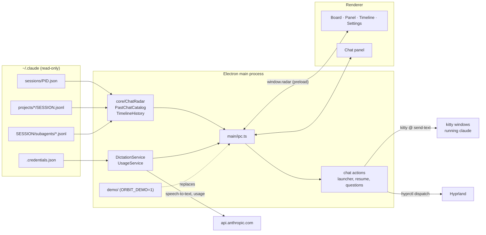

# Architecture

Orbit is an Electron app with three layers. The **core** reads what Claude Code writes under
`~/.claude`, the **main process** answers the UI over IPC and acts on chats through kitty and
Hyprland, and the **renderer** draws the views. Nothing in the core writes to Claude Code's files.

## Polling, not watching

The renderer asks for the chat list every 2 seconds and for the open chat's transcript on the same
beat. Transcripts can grow to hundreds of megabytes, so the core reads only the tail of each file and
memoizes results by file modification time (`src/core/file-memo.ts`, `src/core/tail-search.ts`).

## From files to a chat snapshot

1. `session-registry.ts` lists `~/.claude/sessions/<pid>.json` and drops stale files by checking the
   process start time in `/proc/<pid>/stat`.
2. `transcript-locator.ts` finds the chat's transcript by session id.
3. `color-tracker.ts`, `subagent-reader.ts` and `repository-resolver.ts` add the `/color`, the agents
   and the git repository.
4. `transcript-reader.ts` and `transcript-extractor.ts` turn transcript records into the
   `TranscriptItem` union in `src/shared/types.ts` (messages, tool calls, peer messages, notices,
   turn dividers, questions).

## Acting on a chat

The main process finds the chat's kitty window by walking the chat's parent processes up to a
Hyprland client (`terminal-window.ts`, `kitty-windows.ts`). Text goes in through kitty's
remote-control socket as a bracketed paste followed by Enter (`kitty-remote.ts`,
`terminal-input.ts`). Kitty windows started without the socket fall back to focusing the window and
typing with `wtype` (`keyboard-typer.ts`).

Pending questions are not in the transcript until they are answered, so `main/questions/` reads the
picker straight off the terminal screen (`kitty @ get-text`) and answers it with key presses. Each
answer re-reads the screen first and refuses if the question changed.

## The IPC contract

`src/shared/types.ts` defines `RadarApi`, the only surface the renderer sees (`window.radar`), and
`src/shared/ipc-channels.ts` names the channels. `src/main/ipc.ts` wires them to the real services.
In demo mode `src/demo/demo-ipc.ts` registers the same channels instead. Its route table is typed
over every channel, so a channel added without a demo answer fails the type check.

## Code layout

| Folder | Holds |
| --- | --- |
| `src/core/` | Readers for sessions, transcripts, agents, past chats, timeline history and usage |
| `src/main/` | Electron entry, IPC, windows, kitty and Hyprland actions, dictation, launcher |
| `src/main/questions/` | Reading and answering the terminal's question picker |
| `src/preload/` | The `RadarApi` bridge |
| `src/renderer/` | App shell, nav, theme, board cards and menus |
| `src/renderer/views/` | Board, Panel (`grid/`), Timeline and Settings |
| `src/renderer/sheet/` | The chat panel: thread, composer, agents, dictation, questions |
| `src/renderer/resume/`, `new-chat/` | Resume popover and New chat menu |
| `src/shared/` | Types, IPC channel names, small helpers shared by both sides |
| `src/demo/` | Made-up data and handlers for `ORBIT_DEMO=1` |
| `tests/` | vitest suites; `tests/fixtures/picker/` holds captured terminal screens |
